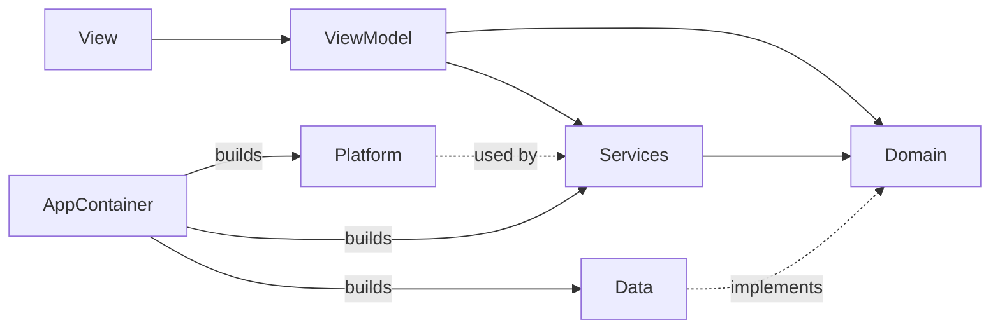

<div align="center">


# ChatBot

**AI text chat and template-based AI video generator for iOS**

SwiftUI · iOS 16+ · Clean Architecture · Apphud · Swift Testing

</div>

---

## Contents

- [Overview](#overview)
- [Getting started](#getting-started)
- [Feature tour](#feature-tour)
- [Architecture](#architecture)
- [Networking](#networking)
- [Video generation pipeline](#video-generation-pipeline)
- [Monetization (Apphud)](#monetization-apphud)
- [Performance and memory](#performance-and-memory)
- [Security and privacy](#security-and-privacy)
- [Testing](#testing)
- [Requirements checklist](#requirements-checklist)
- [Decisions and trade-offs](#decisions-and-trade-offs)

---

## Overview

ChatBot implements the provided Figma design end to end:

| Module | What it does |
|---|---|
| **AI Chat** | Conversations with an assistant, markdown replies, Copy / Regenerate, Share, Pin, Rename, Delete, local history |
| **AI Video** | Template catalog by category, preview pager, photo upload, format and quality, background generation, playback, save to Photos, share |
| **Flow** | Splash → two-page onboarding → Apphud paywall → main screen, plus History (Chat / Video) and Settings |

Every network screen has **Loading, Success and Error** states with a retry path. Locked actions open the paywall, and access unlocks **right after purchase, without a restart**.

## Getting started

```bash
open ChatBot.xcodeproj
```

Pick the **ChatBot** scheme and an iPhone simulator, then run. No setup is needed.

| Item | Value |
|---|---|
| Xcode | 26 or newer (built with Xcode 27) |
| Deployment target | iOS 16.0, iPhone, dark appearance |
| Dependencies (SPM) | [ApphudSDK](https://github.com/apphud/ApphudSDK) 3.6, [Lottie](https://github.com/airbnb/lottie-spm) 4.6 |
| Bundle ID | `com.labs.fviu` |

**Purchases on the simulator.** The scheme attaches `Store.storekit`, which mirrors the Apphud `main` paywall products (`week_4.99_nottrial`, `year_39.99_nottrial`). A run from Xcode shows real prices and completes test purchases. On a device, use a sandbox Apple ID.

**Configuration.** API endpoints and keys are not in Swift code. `Configuration/Base.xcconfig` and `Configuration/Secrets.example.xcconfig` fill `Configuration/Info.plist`, and `AppConfig` reads that plist at runtime. To use different keys, put the same settings into a git-ignored `Configuration/Secrets.xcconfig`; it overrides the defaults.

## Feature tour

<details open>
<summary><b>AI Chat</b></summary>

- A new chat opens with the keyboard up and four suggestion chips. A chip fills the input; it never sends on its own.
- The input grows to three lines, then scrolls inside. Send stays pinned and is disabled while the field is empty or a reply is generating.
- The user message appears at once, then a typing indicator, then the reply rendered as markdown.
- **Copy** is under every reply. **Regenerate** is only under the last one and re-asks the same prompt without a duplicate message.
- The `•••` menu has Share (system share sheet), Pin / Unpin and Delete (confirmation alert).
- Failures show an inline message with **Try again**. Offline and timeout errors read in plain language.
</details>

<details open>
<summary><b>AI Video</b></summary>

- The catalog has about 880 templates, grouped into category chips with Popular first. The header and chips stay fixed while the grid scrolls.
- Visible cells autoplay muted previews. Others show a cached first frame.
- The preview pager plays the current template and pages through its category. The title follows the page.
- The photo slot opens the system picker. The photo is decoded off the main thread, center-cropped to the chosen format and compressed. Create is enabled only when the photo is ready.
- Format (16:9 / 9:16 / 1:1) and Quality use dropdowns, with qualities taken from the template.
- Generating shows the Lottie loader. Back does **not** cancel the job: it keeps running and shows up in History.
- The result keeps its aspect ratio, starts paused, loops on tap, and has Replace, Share and Download (save to Photos with a toast).
</details>

<details open>
<summary><b>History, Settings, Paywall</b></summary>

- **History · Chat:** Pinned first, then Today / Yesterday / dates. Swipe a row left for Rename (Save is disabled while the name is empty) or Delete.
- **History · Video:** a two-column masonry that keeps each video's aspect ratio. Cards show **In progress → New → opened**, or **Error + Try again**.
- **Settings:** Rate app, Share, Upgrade plan, Notifications, Clear cache (shows its size), Restore purchases, Contact us, Privacy and Usage policy, app version.
- **Paywall:**
  - Plans and prices come from Apphud products; the "SAVE N%" badge is computed from them.
  - Restore, Privacy and Terms links are included.
  - The close button fades in after 2 seconds, as specified.
</details>

## Architecture

Clean-architecture layers with MVVM in the presentation layer. Dependencies point inward to `Domain`.

```
ChatBot/
├── Application/   App entry, AppContainer (composition root), AppRouter + AppRoute, PremiumGate, AppConfig
├── Domain/        Entities and repository protocols — no UIKit, SwiftUI, networking or SDK imports
├── Data/          URLSession API client, endpoints, DTOs, mappers, file persistence, repositories, Apphud
├── Platform/      Device and file infrastructure: video and thumbnail caches, photo library, ATT, image processing
├── Services/      App-lifetime state: ChatStore, VideoGenerationCoordinator, VideoTemplatesStore, SubscriptionManager
├── Presentation/  DesignSystem (tokens + components), Root navigation, Features/<Screen> (View + ViewModel)
└── Resources/     Fonts, Lottie animation, String Catalog, privacy manifest
Configuration/     xcconfig files and Info.plist template
ChatBotTests/      Swift Testing suites mirroring Data / Domain / Services
```



| Concern | Approach |
|---|---|
| **Dependency injection** | `AppContainer` creates every concrete type once. View models receive only what they use, through their initializers. |
| **Navigation** | One `NavigationStack` driven by `AppRouter.path: [AppRoute]`. The paywall is a full-screen cover. |
| **State** | `@MainActor` `ObservableObject` view models, since iOS 16 rules out the Observation framework. Screen state uses `Loadable<T>` or small enums instead of loose flags. |
| **Models** | Split per layer. Domain entities (`Chat`, `VideoGeneration`, …) are what screens see. API DTOs (`*DTO`) and stored records (`Stored*` in a versioned envelope) stay in `Data` and are converted in `Data/Mappers`. |
| **Design system** | Color, gradient, typography, spacing and radius tokens, plus about 25 reusable components (buttons, headers, chips, toasts, alerts, menus, players, loaders). |
| **Paid actions** | One `PremiumGate` rule covers chat send, regenerate and retry, and video create and retry. |

## Networking

`URLSessionAPIClient` turns `Endpoint` values into requests:

- It adds the bearer token, plus `user_id` (the Apphud user id) and `app_id` where the API expects them.
- It encodes JSON or multipart bodies.
- It maps transport and HTTP failures into one `APIError` with user-facing messages.
- Uploads get a longer timeout than plain calls.
- Cancelling a task cancels its request.

| Feature | Endpoint |
|---|---|
| Chat reply | `POST /dola/dola/chats/{chat_id}/messages` |
| Template catalog | `GET /pixverse/api/v1/get_templates/{app_id}` |
| Start generation | `POST /pixverse/api/v1/template2video` (multipart: template, photo, quality) |
| Generation status | `GET /pixverse/api/v1/status?id=` (polled every 30 s) |

> The test backend answers every chat message with the same sandbox reply and every generation with the same sample video. That is expected for this assignment; it is not a client bug.

## Video generation pipeline

`VideoGenerationCoordinator` owns jobs for the whole app lifetime, not a screen.

1. **Create:** the record and the prepared photo are saved first, so History shows "In progress" immediately.
2. **Submit:** the job is sent to the backend and its id is persisted.
3. **Poll:** the status is checked every 30 seconds.
   - Transient failures (offline, timeout, 5xx) are retried, up to 5 in a row; being offline never counts against that limit.
   - The deadline is measured from the job's creation.
4. **Resume:** unfinished jobs are picked up after a relaunch.
5. **Retry:** a failed job is resubmitted with the same photo and parameters, without a new pick.

## Monetization (Apphud)

- `ApphudSubscriptionRepository` loads the `main` paywall. It is not attached to a placement in the test project, so the repository falls back to the user's paywall list.
- Prices, periods and savings come from StoreKit products.
- Purchase and restore are guarded against double taps. Apphud's paywall shown and closed events are reported.
- `SubscriptionManager.isPremium` caches the SDK answer. Apphud remains the source of truth, through the purchase result, restore and `ApphudDelegate`.
- **Unlock without restart:** `isPremium` is `@Published`. The PRO badge disappears and locked actions open as soon as a purchase completes.
- **ATT:** the system prompt appears right after launch. The IDFA (only when tracking is allowed) and the IDFV are passed to Apphud for attribution.

## Performance and memory

| Area | What is done |
|---|---|
| Video playback | `AVPlayerViewController` without chrome, looping with `AVPlayerLooper`. One player per visible preview, released on disappear, resumed after background or interruption. |
| Grids | `LazyVGrid` and `LazyVStack` with stable ids. At most **4 autoplaying cells** at once (`AutoplaySlots`); other cells show stills. The system "Auto-Play Video Previews" setting is respected. |
| Thumbnails | Memory cache, then disk cache, then decoding. Requests for the same URL are de-duplicated, at most 4 decoders run at once, and each decode times out after 15 s. |
| Photos | ImageIO decodes straight to 1536 px (no full-size bitmap) off the main thread, then crops and compresses. |
| Persistence | JSON in an actor-isolated `FileStore`. Writes are atomic, ordered and debounced, and flushed when the app goes to the background. |
| Chat | The draft text lives in its own object, so typing re-renders only the input bar. Rows are `Equatable`. Scroll and animation run once per change. |

## Security and privacy

- No secrets in Swift code. Configuration comes from xcconfig through Info.plist, and `Secrets.xcconfig` overrides are git-ignored.
- App Transport Security is untouched; every endpoint is HTTPS.
- Logging uses `os.Logger`, never writes tokens or message text, and Apphud debug logs are enabled only in `DEBUG`.
- Files use `completeFileProtectionUntilFirstUserAuthentication`. An unreadable history file is moved aside instead of being silently overwritten.
- A `PrivacyInfo.xcprivacy` manifest is included. The app has usage descriptions for photo library read, photo library add and tracking.
- The system photo picker is used, so the app never browses the library itself.

## Testing

```bash
xcodebuild test -project ChatBot.xcodeproj -scheme ChatBot \
  -destination 'platform=iOS Simulator,name=iPhone 17'
```

**241 Swift Testing cases in 23 suites, all passing.** They use hand-written fakes, have no network or fixed sleeps, and use a `URLProtocol` stub for HTTP.

- **Network:** request building, multipart encoding, status and error mapping.
- **Mapping and storage:** DTO decoding, persistence round-trips, file storage including corrupt-file recovery.
- **Stores:** `ChatStore` (debounce, flush, blocked saves after a failed load), `VideoTemplatesStore` (category grouping).
- **Video jobs:** `VideoGenerationCoordinator` (success, failure, retry, resume after relaunch, transient errors, deadline).
- **Purchases:** `SubscriptionManager` (purchase, cancel, restore, paywall events) and pricing maths.

## Requirements checklist

| Requirement | Status |
|---|---|
| SwiftUI, iOS 16+ | ✅ |
| Clean architecture, readable code | ✅ Layers, DI, one type per file, design tokens |
| AI Text Chat: send, replies, history | ✅ |
| AI Video: template, request, state, result | ✅ |
| Onboarding, paywall, history, settings | ✅ |
| Real API requests with Loading / Success / Error | ✅ |
| Apphud: project, paywall, status, gating, unlock without restart | ✅ |
| Smooth transitions, no abrupt UI changes | ✅ Cross-fades, springs, staged appearance |
| No crashes | ✅ No `!`, `try!`, `as!` or `fatalError` in production code |
| Reusable components, file organization, memory handling | ✅ See sections above |

## Decisions and trade-offs

- **iOS 16 target.** The assignment requires iOS 16, which rules out `@Observable`, SwiftData and newer SwiftUI scroll APIs. The code uses `ObservableObject` and file-based persistence.
- **Local history.** The API has no endpoints to pin, rename or delete chats, so local storage is the source of truth and the server provides replies.
- **Format.** The template endpoint has no aspect-ratio field, so the selected format is applied by cropping the photo before upload.
- **Chat requests are tied to the screen.** Closing a chat cancels its in-flight reply. The message is kept, and reopening the chat offers Try again. Video jobs, which take minutes, run in the background instead.
- **Placeholders.** The Privacy, Terms and Usage links, the support e-mail and the App Store link in `AppConfig.Links` stand in for real product URLs.
- **Credentials.** The API token and Apphud key in `Secrets.example.xcconfig` are the ones issued with the assignment. They are kept so the project runs immediately.
